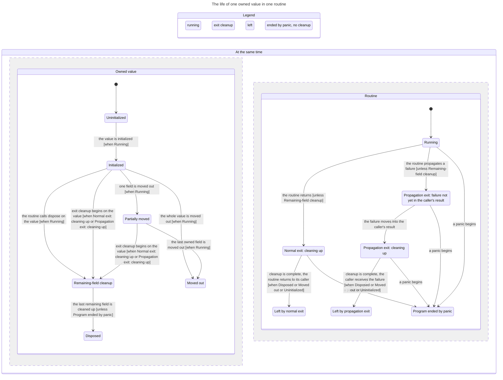
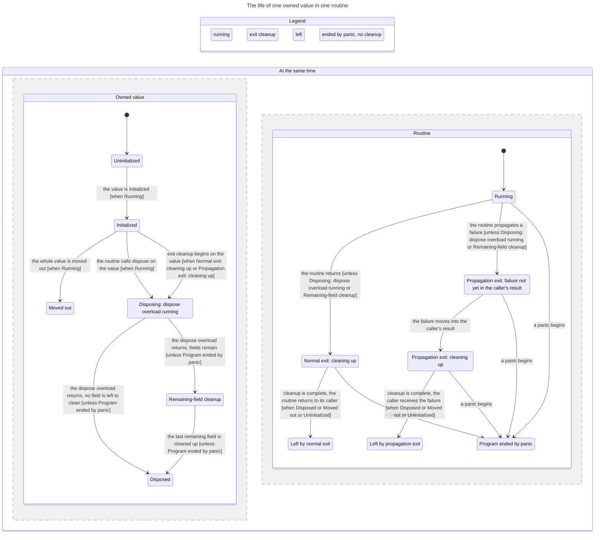
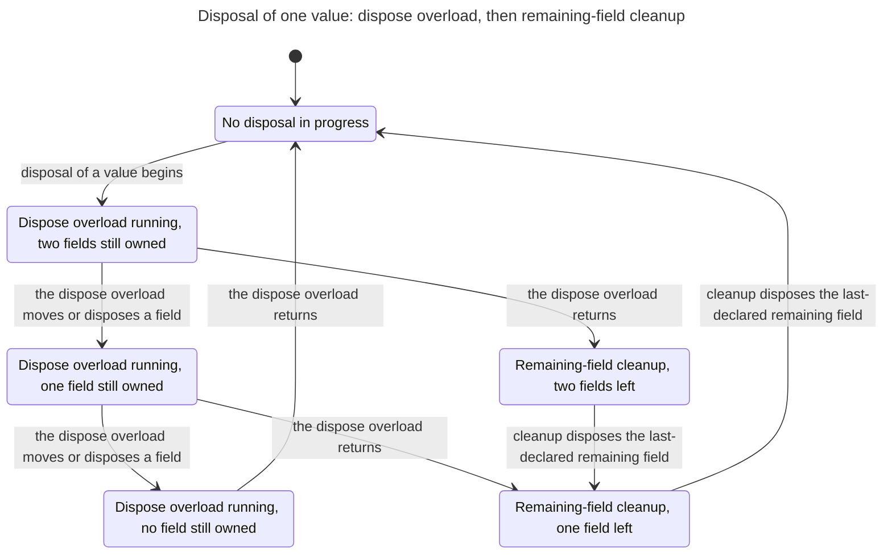
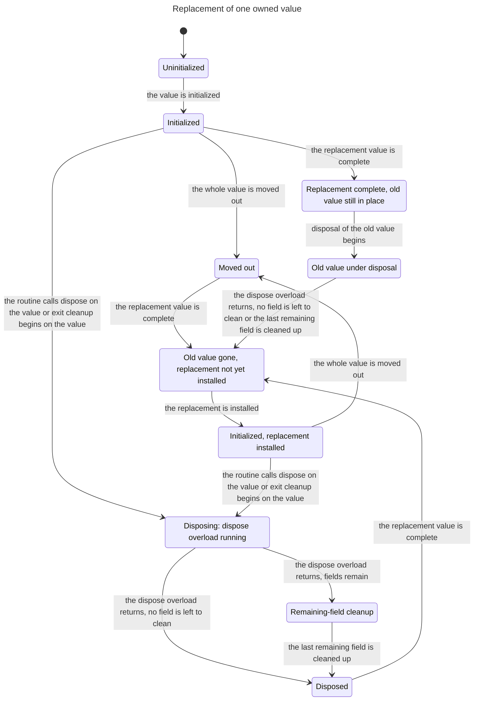
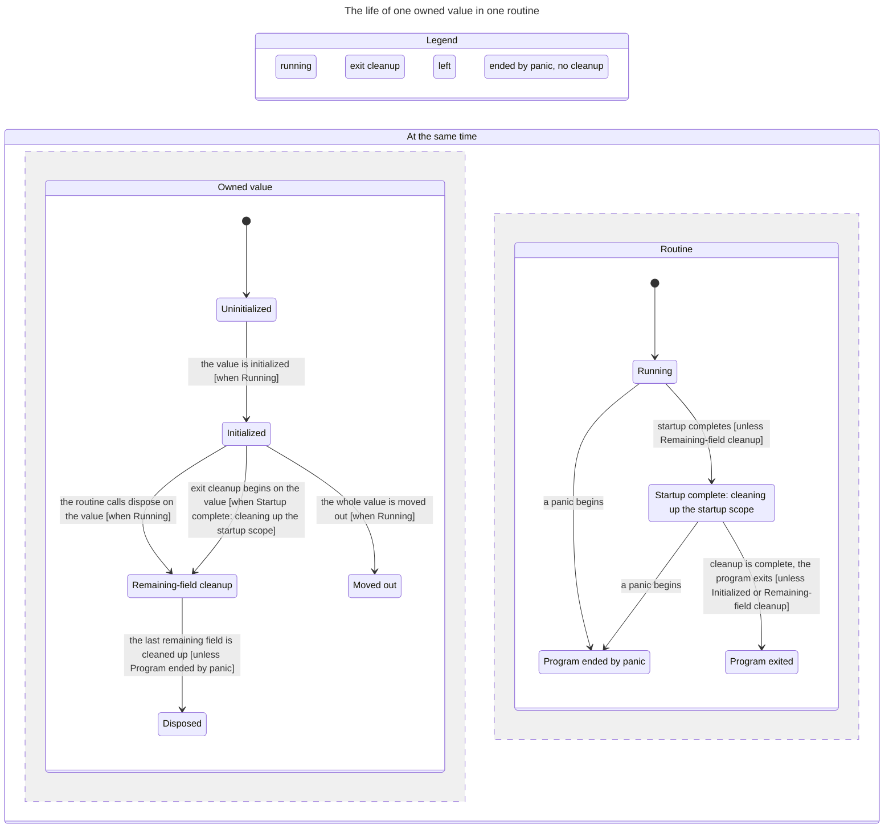
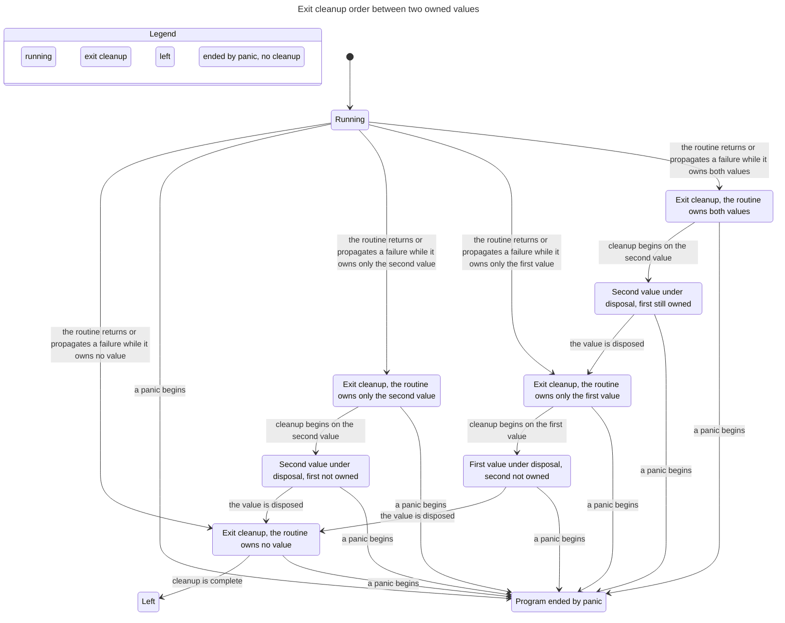
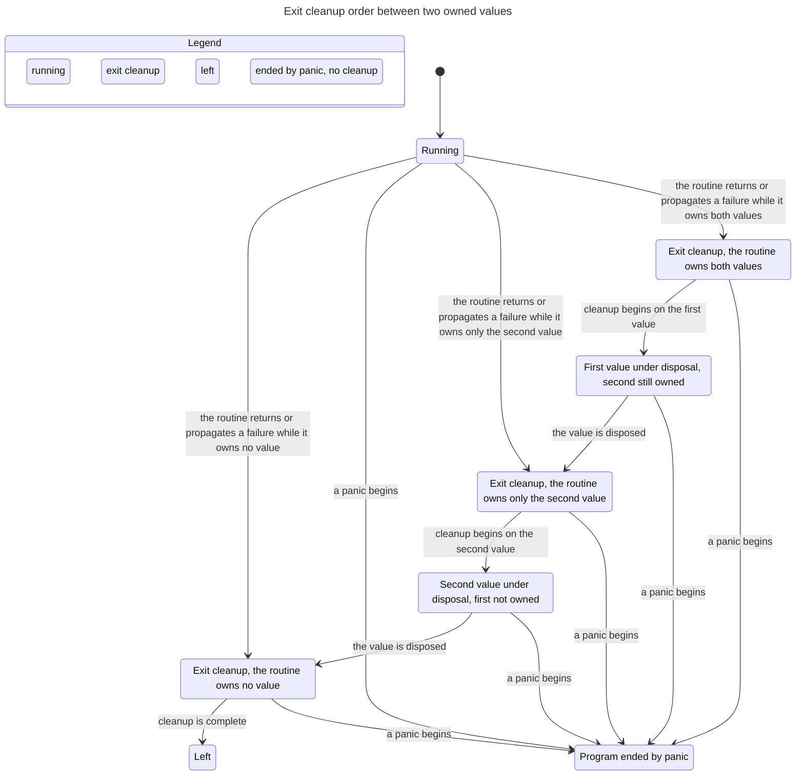

# Statechart 1: the life of one owned value in one routine

City bead ci-ca3c, for M6 (bead ri-qlh, owner decisions Q12 and Q13). This is a TLA+ model of run-time cleanup in one routine, checked with TLC and drawn as Mermaid statecharts. It is the proposed acceptance model for single-routine cleanup: each rule below is to get one named run-time test per exit.

The model was written from the documents, not extracted from the compiler. Nothing in the repository executes Rill yet, so no rule here has been observed at run time. The owner has not yet agreed the rules.

## Scope

One routine, no concurrency and no cancellation. The routine owns one or two places. Each place holds a record with one or two fields, with or without a `dispose` overload.

```rill
type Holder = { first: Part, second: Part };
dispose(holder: Holder) { ... }      // only in the configs with a dispose overload

function routine(): Result<...> {
    let a: Holder = ...;             // first place
    let b: Holder = ...;             // second place
    // between statements: move a value or one field out, dispose(a),
    // a = <replacement>, return, propagate a failure with `?`, or panic
}
```

In the `startup` configs the same statements are the program's startup, and the ordinary exit is the end of startup.

## Sources

Read at `origin/main` `870bce6b` and `origin/implementation/m5-ownership-cleanup` `9f6b4e7b`:

- `docs/research/m6-prerequisites.md` sections 5.2 and 5.3: the states and events, with citations.
- `docs/rfcs/0007-ownership-borrowing-mutation-and-cleanup.md`: replacement phases, destructor-safe partial moves, deterministic cleanup scheduling.
- `docs/rfcs/0008-errors-propagation-and-caused-by-wrapping.md`: postfix propagation and normal return.
- `docs/adr/0005-panics-end-the-program-without-unwinding.md`.
- Bead ri-qlh, M6 charting round 2: Q12 (startup-scope values are cleaned up before the program exits; a panic runs no cleanup) and Q13 (this chart).
- `GLOSSARY.md`: dispose, borrow dependency.

## Rules

Each rule is a TLA+ invariant in `OwnedValue.tla`. "The routine still owns a value" means the value is Initialized or PartiallyMoved in one of the routine's places.

| # | Invariant | The rule in plain words | Source |
| --- | --- | --- | --- |
| R1 | `ValueDisposedAtMostOnce` | Disposal of a value begins at most once, and its `dispose` overload runs at most once. | RFC 0007 cleanup scheduling; m6-prerequisites 5.2 cleanup 3 and 5 |
| R2a | `NormalExitDisposesEachOwnedValueOnce` | When the routine returns, every value it still owns has been disposed exactly once. A value that was never initialized or was moved out is not disposed. | RFC 0007 "Values normally reach cleanup at their owning scope boundary" |
| R2b | `PropagationExitDisposesEachOwnedValueOnce` | The same when the routine leaves by propagating a failure with `?`. | RFC 0008 "Normal early exits perform the required ownership cleanup" |
| R2c | `ProgramExitDisposesEachStartupValueOnce` | The same for the startup scope when startup completes, before the program exits. | Owner decision Q12 |
| R3 | `MovedValueNeverDisposed` | A value that was moved out is never disposed by the routine it left. | RFC 0007 "ownership transfer can end a particular value earlier" |
| R4 | `MovedOrDisposedFieldNeverDisposed` | A field that was moved out, or that the `dispose` overload already disposed, is never disposed again. | RFC 0007 "Its moved/disposed fields are not disposed twice"; `GLOSSARY.md` Dispose |
| R5 | `DisposeOverloadRunsBeforeFieldCleanup` | For a type with a `dispose` overload, the overload runs and returns before remaining-field cleanup begins. | RFC 0007 "A custom outer disposer runs before remaining-field cleanup" |
| R6 | `DependentCleanedUpBeforeSource` | Disposal of a source does not begin while a value that borrows from it is live or still under disposal. | RFC 0007 "order eligible dependents before the sources they need"; "Dependencies it may use stay valid until that action completes" |
| R7 | `CleanupInReverseDeclarationOrderOtherwise` | Without a borrow dependency between them, exit cleanup takes values in reverse declaration order. | RFC 0007 "Reverse local declaration order breaks ties" |
| R8 | `PanicDisposesNothing` | After a panic begins, no value and no field changes state: no overload runs and no cleanup runs. | ADR 0005; owner decision Q12 |
| R9 | `FailureExportedBeforeCleanup` | On a propagation exit, the failure is in the caller's result before cleanup of any place begins. | M5 lowering only: see open question 1 |
| R10 | `OldValueGoneBeforeInstallation` | A replacement is installed only after the old value has left the place: disposed there, or moved out earlier. | RFC 0007 replacement phases 4 and 5 |

Remaining-field cleanup takes fields in reverse declaration order (RFC 0007). The model does this by construction and has no separate invariant for it.

The model also assumes three checker rules, and so never takes these steps: a field is not moved out of a type with a `dispose` overload; a whole value is not moved or disposed while one field is moved out; a source is not moved, disposed or replaced while a value that borrows from it is live.

## Results

TLC 2.19, run on 2026-11-24. `NoDeadlock` also holds in every config. No rule breaks without a seeded fault.

| Config | Places | Fields | `dispose` overload | Frame | Distinct states | Rules |
| --- | --- | --- | --- | --- | --- | --- |
| `record` | 1 | 2 | no | function | 102 | all hold |
| `overload` | 1 | 2 | yes | function | 262 | all hold |
| `replacement` | 1, assigned again once | 1 | yes | function | 478 | all hold |
| `startup` | 1 | 1 | no | startup | 26 | all hold |
| `two-independent` | 2 | 1 | no | function | 240 | all hold |
| `two-second-borrows-first` | 2, the second borrows from the first | 1 | no | function | 158 | all hold |
| `two-first-borrows-second` | 2, the first borrows from the second | 1 | no | function | 158 | all hold |

The fault configs are not claims about the compiler. Each seeds one wrong behavior to show that a rule can fail in this model, so that a pass above is not vacuous. Every rule breaks under at least one fault.

| Fault config | Seeded behavior | Rules that break |
| --- | --- | --- |
| `fault-exit-cleanup-repeats-ended-values` | Exit cleanup disposes a value that was moved out or disposed earlier. | R1, R2a, R2b, R3 |
| `fault-field-cleanup-ignores-the-overload` | Remaining-field cleanup disposes fields that the overload moved or disposed. | R4, R2a, R2b |
| `fault-field-cleanup-before-the-overload` | Remaining-field cleanup runs before the overload. | R5 |
| `fault-cleanup-ignores-dependencies` | Exit cleanup uses reverse declaration order only. | R6 |
| `fault-cleanup-in-declaration-order` | Exit cleanup uses declaration order. | R7 |
| `fault-panic-runs-cleanup` | Exit cleanup runs after a panic. | R8 |
| `fault-cleanup-before-export` | Cleanup can begin before the failure is in the caller's result. | R9 |
| `fault-installation-skips-old-disposal` | The replacement is installed over a live old value. | R10, R2a, R2b |
| `fault-program-exit-skips-cleanup` | The program exits without cleaning the startup scope. | R2c |

Each `results/<config>/report.md` gives the shortest path to every break, and `tlc.out` is TLC's output. The fault charts use the same views as the charts below, which merge states that break a rule with states that do not, so they mark some states as "breaks in some cases". Read the paths in their `report.md`.

## Charts

In the two-region charts, the upper region is the owned value and the lower region is the routine. Blue is running, orange is exit cleanup, teal is a completed exit and pink is the end of the program by a panic. A panic has no arrow in the upper region: the value stays in the state it had.

`record`: an ordinary record with two fields.



`overload`: a record with a `dispose` overload.



`overload`, drawn with `view-disposal.ts`: one disposal, with the fields.



`replacement`, drawn with `view-replacement.ts`: one place that the routine assigns again. This chart leaves out the routine's exits.



`startup`: the startup scope.



`two-independent`, drawn with `view-order.ts`: no borrow dependency, so the second value goes first.



`two-first-borrows-second`: the first value borrows from the second, so the first goes first. `results/two-second-borrows-first/chart.mmd` is the other direction.



What the charts hide:

- Every chart hides the step that keeps a finished or panicked program in place, and draws no arrow for a step that stays in one state.
- In the two-region charts, the steps of a `dispose` overload on single fields stay inside "Disposing: dispose overload running".
- The replacement chart ignores the routine's phase, so returns, propagation, export and panic stay inside one state.
- The disposal chart keeps every step of the routine outside a disposal inside "No disposal in progress".
- The order charts keep every step before the exit inside "Running", and draw a normal return and a propagation as one arrow.

## Open questions for the owner

The documents leave these open. The model does not decide them, except where a line says what it assumes.

1. **Export before cleanup (R9).** RFC 0008 says the failure moves into the enclosing result and that early exits perform cleanup. It does not give the order. M5 lowers a postfix failure as `Export`, then `Cleanup` (`crates/compiler/src/analysis/ownership/build.rs`, "The postfix's failure exports before the lexical cleanup"). Is R9 the rule? Does the same order hold for the result of a normal return? M5 exports an ordinary result before cleanup, but keeps a returned callable staged "across lexical and parameter cleanup" and exports it after (`flow.rs`). The model checks only the propagation exit.
2. **Replacement of a partially moved place.** RFC 0007 phase 4 says "Dispose the old value if its ownership remains in the destination". It does not say what happens when only some fields remain. Are the remaining fields cleaned before installation, or is the assignment rejected? The model does not take this step.
3. **Assignment after `dispose(place)`.** May a place be assigned again after an explicit dispose, as after a move? The model allows it and installs with no second disposal.
4. **`dispose` on a type with no overload.** The model lets the routine call `dispose` on an ordinary record, and goes straight to remaining-field cleanup. Bead ri-qlh.14 records that M5 gives this no typed receipt.
5. **A record with every field moved out one at a time.** The model treats it as Moved: nothing is cleaned at exit.
6. **Propagation from startup.** The model gives the startup scope no propagation exit, because RFC 0008 requires an enclosing callable that returns a `Result`. Is that right?
7. **Startup values of several modules.** Q12 says startup-scope values are cleaned up before exit. In which order are the startup scopes of different modules cleaned? Not found.
8. **Order beyond two places in one scope.** RFC 0007: "Complete ordering across nested scopes, temporaries, partial construction and custom-body exits still needs formal specification." The model has two places in one scope.
9. **A panic inside a `dispose` overload or inside exit cleanup.** The model treats it as any other panic: nothing more runs, and the values not yet cleaned stay as they are. ADR 0005 implies this and does not name the case.

## What a run-time test would observe in M5 MIR

M5 executes nothing. These are the MIR operations on `origin/implementation/m5-ownership-cleanup` (`crates/compiler/src/analysis/ownership.rs`, enums `Operation`, `Cleanup` and `Terminator`) whose execution a run-time test would count or order.

| Rule | MIR operations to observe |
| --- | --- |
| R1 | Per value, the count of executed `Operation::Dispose`, `Cleanup::InvokeDisposer`, `Operation::Drop` and `Cleanup::Drop` on its place (and the type-specific forms such as `Cleanup::DisposeListText`). Each count is at most 1. |
| R2a | Every `Operation::Initialize(place)` that ran is matched by exactly one of: a `Move` from the place, a `Dispose`, or a member of an `Operation::Cleanup` list, before `Terminator::Return`. |
| R2b | The same on the failure edge of `Operation::ForwardResultFailure` or `WrapResultFailure`, up to `Terminator::Return`. |
| R2c | The same before `Terminator::FinishStartup`. |
| R3 | After `Operation::Move { from }` (or a move into `Export`), no `Dispose`, `Drop` or `Cleanup` member names `from` until an `Install` or `Initialize` of that place. |
| R4 | Inside a disposer body, after a `Move` or `Dispose` of a field, the epilogue's `Cleanup::Drop` list does not name that field. `Cleanup::DeferDisposerFields { from, into }` carries only the initialized remainder. |
| R5 | `Cleanup::InvokeDisposer` on the value runs before any `Cleanup::Drop` of its fields; inside the disposer, `DeferDisposerFields` and the field drops come after the body's operations. |
| R6 | `Cleanup::EndStorage` (or the drop) of the holder from `Operation::Borrow { source, holder }` runs before the `Cleanup` member that ends `source`. |
| R7 | The order of the members of the exit's `Operation::Cleanup(Vec<Cleanup>)` list, against the declaration order of their places. |
| R8 | After a trapping operation (`CheckedI32Add` or `CheckedI32Multiply` on overflow, `ReadListI32` out of bounds), no `Cleanup`, `Dispose` or `Drop` runs. In MIR these have "no cleanup or normal successor". |
| R9 | `Operation::Export(place)` runs before the `Operation::Cleanup` block on the path from `ForwardResultFailure` to `Terminator::Return`. |
| R10 | The `Cleanup` or `Dispose` of the target's old value runs before `Operation::Install { target, incoming }`; when the old value was moved, no such operation runs and `Install` still follows. |

## What the model leaves out

- The compiler. A pass says the rules are consistent with each other in this routine, not that the compiler obeys them.
- Cancellation, concurrency, guards, joins and native completion. These belong to chart 2.
- Where a moved value goes. The model stops following a value when it leaves its place.
- Partial construction, same-type rebuilding, statement temporaries, nested scopes, loops and branches.
- Tuple, List and Map elements, and fields that are themselves records with a `dispose` overload.
- Writing a field back into a partially moved record.
- The exit of an expectation in `rill test`.
- More than one replacement of a place, and more than two places.
- Fatal exhaustion and stack overflow, which end the program as a panic does.

## Reproduce

The statechart command comes from the city repository's `statechart` skill. Its first run installs TLC and Java with mise and needs the network. Run it from this directory, with a new `--out` folder each time:

```sh
STATECHART=/path/to/city/.agents/skills/statechart/scripts/statechart
OUT=/tmp/owned-value
for config in record overload startup fault-exit-cleanup-repeats-ended-values \
    fault-field-cleanup-ignores-the-overload fault-field-cleanup-before-the-overload \
    fault-panic-runs-cleanup fault-cleanup-before-export \
    fault-installation-skips-old-disposal fault-program-exit-skips-cleanup; do
  "$STATECHART" OwnedValue.tla --config "configs/$config.cfg" --view view.ts --out "$OUT/$config"
done
for config in two-independent two-second-borrows-first two-first-borrows-second \
    fault-cleanup-ignores-dependencies fault-cleanup-in-declaration-order; do
  "$STATECHART" OwnedValue.tla --config "configs/$config.cfg" --view view-order.ts --out "$OUT/$config"
done
"$STATECHART" OwnedValue.tla --config configs/replacement.cfg --view view-replacement.ts --out "$OUT/replacement"
"$STATECHART" OwnedValue.tla --config configs/overload.cfg --view view-disposal.ts --out "$OUT/overload-disposal"
```

The command exits with status 1 for the fault configs, because rules break there. `results/` holds the recorded runs; `tlc.out` keeps the original scratch paths. `labels.ts` is shared by `view.ts` and `view-replacement.ts` and is not a view.
