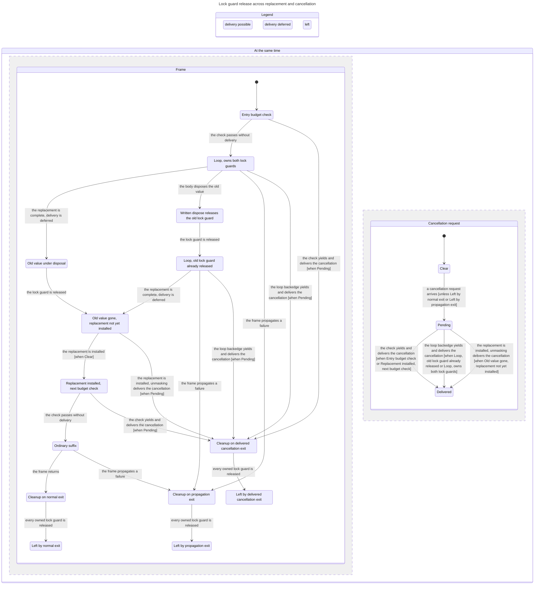
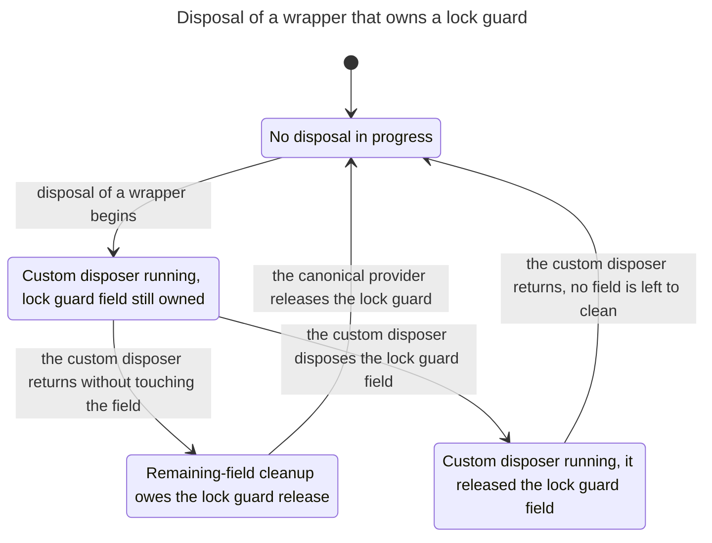

# Statechart experiment: lock guard release across replacement and cancellation

Ticket ri-h4ec. This is a TLA+ model of two M5 rules from the gap analysis, checked with TLC and drawn as Mermaid statecharts:

- **K3**: a lock guard is released exactly once by its canonical provider, and a wrapper cannot suppress the release.
- **K7**: cancellation is deferred through old-value disposal and installation (RFC 0007 case O14).

The experiment asks whether such a chart is a useful review artifact. It changes no compiler code and proves nothing about the compiler. The model was written from the documents and tests below, not extracted from the implementation.

## Sources

Read at `origin/implementation/m5-ownership-cleanup` `b6c93f30`:

- `docs/rfcs/0007-ownership-borrowing-mutation-and-cleanup.md`: replacement phases 1 to 6, deterministic cleanup scheduling, protected actions, case O14.
- `docs/adr/0009-concurrency-safety-and-cooperative-cancellation.md`: request against delivery, and deferral.
- `docs/adr/0015-language-required-library-contracts.md`: canonical protected actions and remaining-field cleanup.
- `GLOSSARY.md`: lock guard, cancellation, dispose.
- `crates/compiler/src/analysis/ownership.rs`: `ReplacementCancellation::after_install` and `PostInstallCheck::advance`.
- `crates/compiler/tests/m5/cancellation.rs`, `m5/cancellation/replacement.rs`, `m5/graph/closed_release.rs`, `m5/disposers.rs` and `m5/disposers/*.rs`.

## What the model describes

One frame owns two lock guards and replaces one with the other:

```rill
function frame(again: bool, old: Holder, incoming: Holder): Result<...> {
    // entry budget check
    let mut current = old;
    while (again) { continue; }      // backedge budget check
    // optional: dispose(current);   // written release
    current = incoming;              // dispose the old value, install the replacement
    leaf();                          // post-install budget check
    // return, or propagate a failure
}
```

`Holder` is `LockGuard<i32>`, or a record with one lock guard field and a custom disposer. A cancellation request can arrive at any step. Delivery happens only at a budget check that yields, or at the unmask after installation when a request is already pending.

| Config | Holder | Frame | Seeded fault |
| --- | --- | --- | --- |
| `bare` | lock guard | delivery enabled | none |
| `wrapper` | wrapper | delivery enabled | none |
| `bare-deferred-caller` | lock guard | runs inside a caller's deferral | none |
| `wrapper-deferred-caller` | wrapper | runs inside a caller's deferral | none |
| `fault-installation-polls` | lock guard | delivery enabled | a delivery between old disposal and installation |
| `fault-empty-disposer-suppresses` | wrapper | delivery enabled | an empty custom disposer skips the remaining-field cleanup |

The two fault configs are not claims about the compiler. They show that the rules can fail in this model, so a pass in the other four is not vacuous.

## Results

TLC 2.19, run on 2026-11-24. `NoDeadlock` also holds in every config.

| Rule | `bare` | `wrapper` | both deferred-caller configs | `fault-installation-polls` | `fault-empty-disposer-suppresses` |
| --- | --- | --- | --- | --- | --- |
| `LockGuardReleasedAtMostOnce` | holds | holds | holds | holds | holds |
| `NormalExitReleasesEachLockGuardOnce` | holds | holds | holds | holds | breaks |
| `PropagationExitReleasesEachLockGuardOnce` | holds | holds | holds | holds | breaks |
| `DeliveredCancellationExitReleasesEachLockGuardOnce` | holds | holds | holds | breaks | breaks |
| `CancellationDuringOldDisposalStaysPendingThroughInstallation` | holds | holds | holds | breaks | holds |
| `DeliveryAfterInstallationCleansInstalledValueOnce` | holds | holds | holds | holds | breaks |
| `NoReleaseSuppressedByWrapper` | holds | holds | holds | holds | breaks |
| Distinct states | 75 | 121 | 58 and 92 | 79 | 212 |

No rule breaks without a seeded fault. Each `results/<config>/report.md` gives the shortest path to every break, and `tlc.out` is TLC's output.

## Witnessing M5 tests

Test names are relative to `crates/compiler/tests/m5/` on the M5 branch. "None" means no test asserts the rule for that shape.

| Rule | Witness | Not witnessed |
| --- | --- | --- |
| `LockGuardReleasedAtMostOnce` | `cancellation::installed_guard_release_on_budget_delivery` (`released`: a lock guard disposed before the loop is not released again on delivery). `disposers::protected_guard_cleanup_follows_the_initialized_owner` (`replaceMoved`, and `rejects` with R0200). | |
| `NormalExitReleasesEachLockGuardOnce` | `graph::closed_release::implicit_guard_release_closes_the_ordinary_root`, `two_guard_parameters_release_in_reverse_and_close_the_root`, `disposers::protected_guard_cleanup_follows_the_initialized_owner` (`replace`: displaced release, install, one final release), and the ordinary suffix of `installed_guard_release_on_budget_delivery`. | |
| `PropagationExitReleasesEachLockGuardOnce` | **None.** | The two bodies that own a lock guard across a propagation, `protectedArg` in `propagation::compound_propagating_results_stay_outside_other_call_routes` and `protected` in `records::interrupted_record_initialization_keeps_unreached_and_unsupported_shapes_separate`, are asserted `Incomplete` with no MIR. |
| `DeliveredCancellationExitReleasesEachLockGuardOnce` | `cancellation::installed_guard_release_on_budget_delivery`: one bare lock guard parameter, at the entry check and at the loop backedge. | Two lock guards in one frame. A lock guard in a wrapper or field. Delivery at the unmask or the post-install check with a lock guard installed. The graph root of `moved` stays `Incomplete`. |
| `CancellationDuringOldDisposalStaysPendingThroughInstallation` | `cancellation::replacement::installed_defers_delivery_through_replacement`: a request at a masked yield inside the old value's custom disposer resumes as `Pending`, and installation follows. | The old value there is a record of strings. No test has a lock guard as the old value. |
| `DeliveryAfterInstallationCleansInstalledValueOnce` | The same test: `UnmaskAfterInstall` and `PostInstallYield` both end in `DisposeInstalledAndExit` with one `InvokeDisposer` on the destination and no second delivery. | The installed value there owns strings. No test has a lock guard, bare or wrapped, as the installed value, so the K3 and K7 rules are not witnessed together. |
| `NoReleaseSuppressedByWrapper` | `disposers::protected_fields_keep_their_obligation_through_disposer_cleanup` (`empty`, `two`, `branch`) on a normal exit. The O21 sources in `rfc_cases.rs` reject an intercepting disposer with R0500. | Any wrapper on a propagation exit or a delivered cancellation exit. `crates/compiler/src/analysis/ownership/flow.rs` admits a delivery frame only when no slot has a custom disposer or members. |

The deferred-caller configs match the `advance` rows of the replacement test that continue with `Pending` when delivery is not enabled.

## Charts

`bare`: the frame and the cancellation request, as two regions. Blue states can deliver a cancellation, orange states defer it, and teal states are exits.



`wrapper`, drawn with `view-disposal.ts`: one wrapper disposal.



The frame chart hides the step that keeps an exited frame in place, and draws no arrow for a step that stays in one state, such as a disposal step during exit cleanup. The disposal chart hides every step of the frame except the three that begin a disposal. The fault charts use the frame view, which merges states that break a rule with states that do not, so they mark states as "breaks in some cases". Read the paths in their `report.md`.

## What the model leaves out

- The compiler. The model follows the documents and two decision functions. A pass says the rules are consistent with each other in this frame, not that the compiler obeys them.
- Exporting a lock guard to the caller, borrows and protected views of the payload, and dependents that must end before the release.
- Callee-entry and retaining-call delivery, scoped children and cleanup joins.
- Cleanup order among more than two values, partial moves and same-type rebuilding.
- Panics and fatal exhaustion, which have no unwinding guarantee.
- Liveness. The model does not check that a pending request is delivered in the end.
- A request that is observed only at a yield. The model lets a request arrive at any step. The rules here do not distinguish the two.

## Reproduce

The statechart command comes from the city repository's `statechart` skill. Its first run installs TLC and Java with mise and needs the network. Run it from this directory, with a new `--out` folder each time:

```sh
STATECHART=/path/to/city/.agents/skills/statechart/scripts/statechart
for config in bare wrapper bare-deferred-caller wrapper-deferred-caller \
    fault-installation-polls fault-empty-disposer-suppresses; do
  "$STATECHART" LockGuardRelease.tla --config "configs/$config.cfg" --view view.ts --out "/tmp/guard-release/$config"
done
"$STATECHART" LockGuardRelease.tla --config configs/wrapper.cfg --view view-disposal.ts --out /tmp/guard-release/wrapper-disposal
```

The command exits with status 1 for the two fault configs, because rules break there. `results/` holds the recorded runs; `tlc.out` keeps the original scratch paths.
